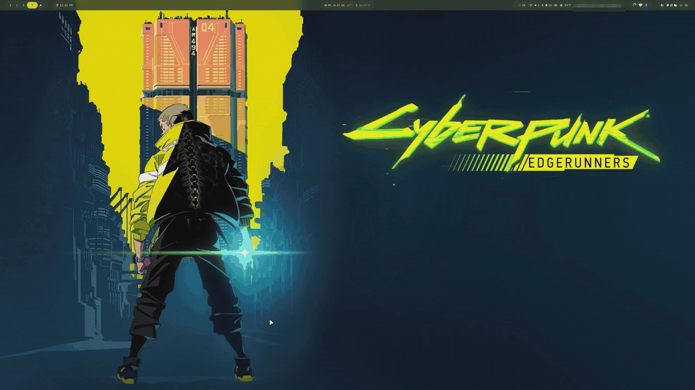
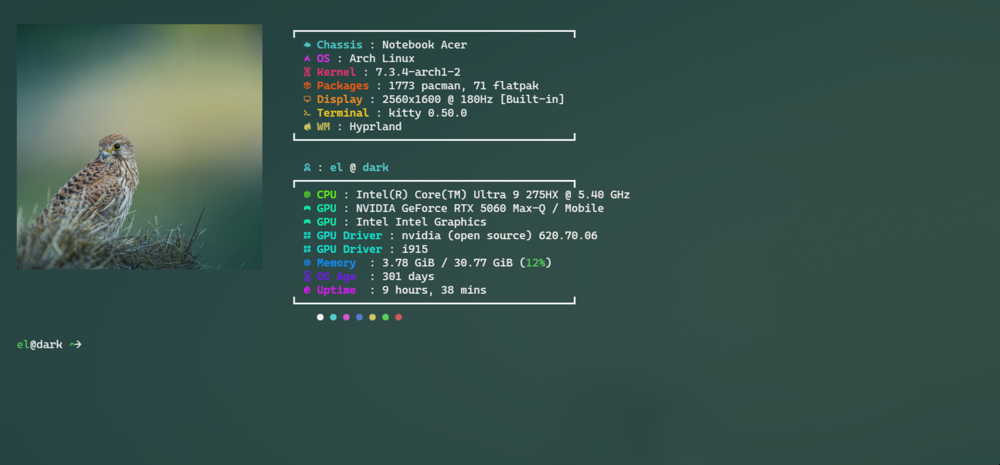
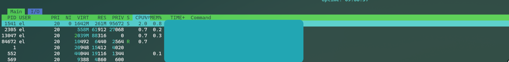

# Arch Linux config

My everyday desktop: Arch Linux with the Hyprland compositor. It's lean, it runs almost entirely from the keyboard, and its Rosé Pine colors adapt to the wallpaper.







*htop with the desktop **idle**: the busiest process uses 2% of the CPU and 0.8% of the memory.*

## What you get

- **Hyprland**, a tiling window manager: new windows arrange themselves side by side, and everything has a keyboard shortcut.
- **A status bar, an app launcher, notifications and a lock screen**, all in one theme.
- **Colors that follow the wallpaper.** The theme is Rosé Pine, and the bar, the terminal and the menus take their colors from the wallpaper you pick.
- **kitty** as the terminal, with **fish** as the shell and fastfetch in every new window.

## Install it, step by step

Never used Arch before? Follow these steps in order. Most of the time goes into downloads.

### 1. Install Arch Linux

1. Download the ISO from [archlinux.org/download](https://archlinux.org/download/) and write it to a USB stick, for example with [balenaEtcher](https://etcher.balena.io/).
2. Start the computer from the stick. At the prompt, connect to the internet: a cable works right away, and for wireless run `iwctl` ([how](https://wiki.archlinux.org/title/Iwd#iwctl)).
3. Run `archinstall`, the guided installer, and choose:
   - **Profile:** Minimal. Step 2 adds the desktop.
   - **Audio:** PipeWire.
   - **Network:** NetworkManager.
   - **User account:** add yourself as a superuser, so your account can use `sudo`.
4. When it finishes, reboot, remove the stick and log in.

The Arch wiki explains every choice: [archinstall](https://wiki.archlinux.org/title/Archinstall).

### 2. Install the base tools

This config runs on top of the [HyDE](https://github.com/HyDE-Project/HyDE) scripts. They install Hyprland, the bar, the menus, the login screen and the theme engine, and they set up NVIDIA graphics if you have it. Run their installer:

```shell
sudo pacman -S --needed git base-devel
git clone --depth 1 https://github.com/HyDE-Project/HyDE ~/HyDE
cd ~/HyDE/Scripts
./install.sh
```

Answer its questions (the defaults are fine). When it finishes, it may show the login screen or a black screen: reboot then.

### 3. Put my config in place

```shell
git clone https://github.com/SinaEsmaeili1/ArchLinuxConfig ~/ArchLinuxConfig
cd ~/ArchLinuxConfig
./install.sh
```

`install.sh` copies each folder into `~/.config`. It first saves whatever was there in a folder named `~/.config-backup-` plus the date, and it points the files at your own home folder.

### 4. Log in and pick the theme

1. Log out and back in (or reboot). If the login screen asks, choose Hyprland.
2. Press **Super + Shift + T** and choose **Rosé Pine**.
3. Press **Super + W** and pick a wallpaper. The colors follow it.

Super is the key with the Windows logo. If the colors look wrong, press **Super + Shift + R** and choose **theme**.

## First keys

| Keys | What they do |
|---|---|
| Super + Enter | Open a terminal |
| Super + D | Open the app launcher |
| Super + E | Open the file manager |
| Super + B | Open the browser |
| Super + Q | Close the window |
| Super + 1 to 9 | Go to that workspace |
| Super + Shift + 1 to 9 | Move the window to that workspace |
| Super + Space | Let the window float, or tile it again |
| Super + Shift + F | Fullscreen |
| Super + W | Pick a wallpaper |
| Super + Shift + T | Pick a theme |
| Super + V | Clipboard history |
| Super + Shift + S | Screenshot of an area |
| Super + Shift + Z | Choose where the sound plays |
| Super + Shift + B | Choose a bar layout |
| Super + Shift + K | Search every shortcut |
| Ctrl + Alt + L | Lock the screen |
| Ctrl + Alt + P | Log out, restart or power off |

## What's in here

| Path | What it sets up |
|---|---|
| `hypr/` | Hyprland: monitors, workspaces, animations, the idle and lock screens, screen shaders and my own keys |
| `waybar/` | The status bar |
| `rofi/` | The app launcher and menus |
| `dunst/` | Notifications |
| `wlogout/` | The log out, restart and power off screen |
| `kitty/` | The terminal |
| `fish/` | The shell, which shows fastfetch in every new terminal |
| `fastfetch/` | The system summary in the screenshot |
| `hyde/` | The Rosé Pine theme and the color templates that follow the wallpaper |
| `gtk-3.0/`, `Kvantum/`, `qt5ct/`, `qt6ct/`, `xsettingsd/`, `kdeglobals` | One look across GTK, Qt and KDE apps |
| `btop/`, `cava/` | The system monitor and the audio visualizer |
| `bin/audio-output-menu` | My audio output picker (Super + Shift + Z) |
| `install.sh` | Puts all of this into `~/.config` |

## If something goes wrong

- **Undo my config:** copy your folders back from `~/.config-backup-...` into `~/.config`, then log out and back in.
- **A black screen after step 2:** reboot once more. The base tools ask for that on the first start.
- **NVIDIA graphics:** the base tools pick the driver, and the [Arch wiki's NVIDIA page](https://wiki.archlinux.org/title/NVIDIA) covers the rest.
- **No picture in fastfetch:** it shows a random image from `~/.config/fastfetch/logo`, so put your own pictures there.

## License

GPLv3 (see [LICENSE](LICENSE)). Parts of these files come from the [HyDE](https://github.com/HyDE-Project/HyDE) project, which is GPLv3 too.
